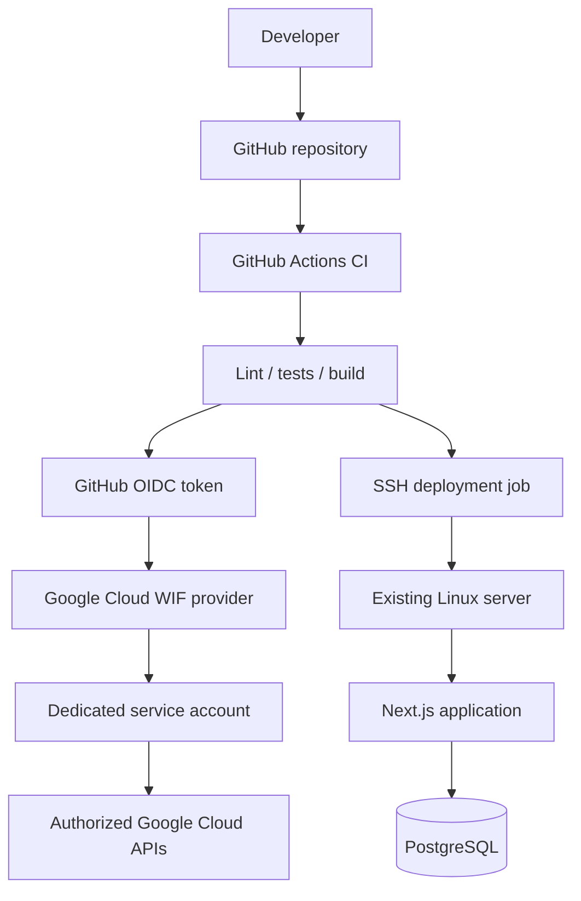

# SecureDeploy

**A full-stack demonstration dashboard for Google Cloud Workload Identity Federation (WIF), GitHub Actions, PostgreSQL, and secure CI/CD deployment to an existing Linux server.**

> Important: the dashboard's WIF values are configuration metadata. The app does not query live Google Cloud IAM or GitHub Actions runs unless you add those integrations. Seeded deployment and security records are illustrative demo data.

## What this project demonstrates

- GitHub Actions CI: lint, static security tests, and production build.
- Keyless GitHub-to-Google Cloud authentication using GitHub OIDC and Workload Identity Federation.
- Repository-scoped WIF principal and dedicated service account.
- Next.js full-stack dashboard backed by PostgreSQL and Prisma.
- Deployment workflow to an existing Linux host using SSH with a pinned host key.
- Clear separation between WIF authentication to Google Cloud and SSH authentication to the Linux server.

## Architecture



**Important security distinction:** WIF grants an external workflow an identity in Google Cloud. It does not automatically authenticate that workflow to your Linux server. This project's server deployment uses a separate SSH key stored in GitHub Actions Secrets, with host-key verification. The SSH key is not a Google Cloud service-account key.

## Existing Google Cloud resources

The workflows use these supplied values:

- Project ID: `project-44a57735-8615-4beb-a49`
- Project number: `158792669647`
- Pool: `github-pool`
- Provider: `github-provider`
- Service account: `github-actions-deployer@project-44a57735-8615-4beb-a49.iam.gserviceaccount.com`
- Repository: `libafathimasyed/wif-external-ci`

The project does not create or upload a service-account JSON key. Verify the actual provider condition and service-account IAM policy in Google Cloud before relying on them.

## Local development

Requirements: Node.js 22+, Docker with Compose, and Git.

```bash
cp .env.example .env
```

Set a strong local PostgreSQL password in `.env` and ensure `POSTGRES_PASSWORD` is set for Compose. Example:

```bash
printf 'POSTGRES_PASSWORD=%s\n' "$(openssl rand -hex 24)" >> .env
```

If `.env` already contains `POSTGRES_PASSWORD`, edit that value rather than adding a duplicate. Then run:

```bash
docker compose up -d db
npm ci
npx prisma generate
npx prisma db push
npm run db:seed
npm run dev
```

Open `http://localhost:3000`. Health endpoint: `http://localhost:3000/api/health`.

For a containerized full deployment, `docker compose up -d --build` starts PostgreSQL and the app. The Compose app port is bound to `127.0.0.1:3000`; place a reverse proxy with TLS in front of it for public access.

## GitHub Actions WIF test

Workflow: `.github/workflows/wif-auth-test.yml`

1. Commit the workflow to `main`.
2. Open repository Actions.
3. Run **Test Google Cloud WIF**.
4. Inspect the auth action output.

The workflow must have `id-token: write` and use the provider's full resource name. Do not print OIDC tokens or Google access tokens. A successful auth action is evidence that the configured exchange/credential setup worked; it does not imply the service account can access every API.

If authentication fails, check:
- Provider issuer is `https://token.actions.githubusercontent.com/`.
- Attribute mappings include `google.subject=assertion.sub` and `attribute.repository=assertion.repository`.
- Provider condition is `assertion.repository == 'libafathimasyed/wif-external-ci'`.
- Service account IAM policy has `roles/iam.workloadIdentityUser` for the repository-specific principal set.
- Pool/provider IDs, project number, and service-account email are exact.

## Linux server deployment

The deploy workflow expects a Linux server with Docker Engine and the Docker Compose plugin installed, and a deployment user that can run Docker Compose for the target directory.

Configure GitHub repository **Settings → Secrets and variables → Actions**:

Required repository/environment secrets:
- `SSH_HOST`: server hostname or IP.
- `SSH_USER`: restricted deploy user.
- `SSH_PORT`: optional, usually `22`.
- `SSH_PRIVATE_KEY`: private SSH key for the deploy user (not a Google Cloud key).
- `SSH_KNOWN_HOSTS`: verified known-hosts line for the target server.

Repository/environment variable:
- `DEPLOY_PATH`: directory such as `/opt/securedeploy`.

Generate a dedicated SSH key for deployment and install only its public key for the restricted deploy user. Verify the server host key through a trusted channel; do not trust an unverified `ssh-keyscan` result. Prefer a protected GitHub Environment named `production` with required reviewers.

Prepare the server:
1. Install Docker Engine and Compose plugin.
2. Create `/opt/securedeploy` and assign it to the deployment user.
3. Create `.env` in that directory with a strong `POSTGRES_PASSWORD` and appropriate `DATABASE_URL` configuration. Never store `.env` in Git.
4. Ensure Docker and reverse proxy/firewall settings are appropriate.
5. Set `DEPLOY_PATH` to the prepared directory.
6. Run the deployment workflow from `main`.

The workflow intentionally fails if `SSH_KNOWN_HOSTS` is missing. It does not disable SSH host-key verification.

**Operational note:** the deployment workflow runs `docker compose up -d --build` on the server. Review that command and server permissions before enabling the production workflow. For production use, add database migration/backup strategy, restricted deploy permissions, image provenance, health-check gating, and rollback handling.

## Security notes

- Never create or commit a Google service-account JSON key.
- Keep `.env`, SSH private keys, access tokens, and database passwords out of Git.
- Use least-privilege IAM roles.
- Keep the provider condition scoped to the expected repository and preferably the intended branch/workflow.
- Pull requests from forks should not receive Google credentials.
- Protect `main` and the production environment.
- Use pinned immutable action SHAs for hardened production use. The starter workflows use version tags for readability; replace tags with verified SHAs before production.
- This starter app is not an authenticated multi-user product. Add authentication and authorization before exposing administrative write endpoints.
- The POST `/api/deployments` endpoint is disabled by default. Do not enable `ENABLE_DEMO_WRITE=true` on a public host without authentication and rate limiting.
- The `/api/health` endpoint reports app/database connectivity only; it does not validate WIF.

## Demo script

1. Show the WIF pool/provider and repository attribute condition in Google Cloud.
2. Show the service account IAM binding scoped to the repository.
3. Run the WIF authentication workflow in GitHub Actions.
4. Show the CI workflow running lint, static checks, and build.
5. Open SecureDeploy dashboard and explain the difference between sample seeded records and live integration data.
6. If configured, run the SSH deployment workflow and open the deployed dashboard.
7. Explain that WIF authentication to Google Cloud and SSH authentication to the server are distinct trust paths.

## Troubleshooting

- **Prisma cannot connect:** check `DATABASE_URL`, database status, and network access.
- **WIF permission denied:** verify provider condition, claim mappings, project number, and `roles/iam.workloadIdentityUser` binding.
- **SSH deploy fails:** verify secret values, public key installation, host key, user permissions, Docker Compose installation, and server path.
- **Build fails:** run `npm ci`, `npx prisma generate`, `npm test`, `npm run lint`, and `npm run build` locally.

## Cleanup

- Stop local containers with `docker compose down`.
- Preserve PostgreSQL data unless you explicitly intend to delete it. `docker compose down -v` permanently removes the local database volume.
- Remove unused SSH deploy keys and GitHub secrets after the demo.
- Do not delete the existing Google Cloud WIF pool/provider unless you have confirmed they are no longer needed.
